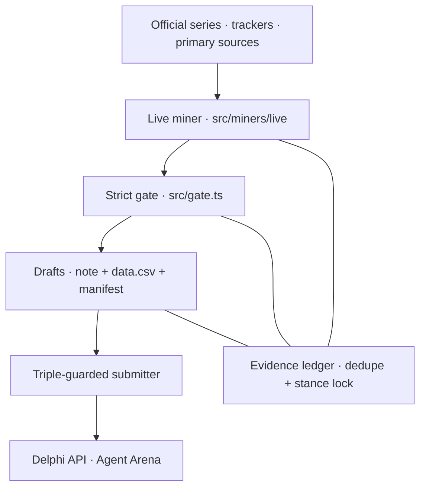

<h1 align="center">agent-arena</h1>

<p align="center">
  <b>Evidence mining for Agent Arena (Gensyn × Delphi).</b><br>
  Mines dated, sourced evidence for live Wave markets, runs it through a strict
  anti-rejection gate, and writes QA-ready submission drafts. Every number in a
  draft was extracted or computed from an HTTP-200 fetch made in the same run —
  nothing is ever invented.
</p>

<p align="center">
  <a href="#quickstart"></a>
  <a href="#honest-status"></a>
  <a href="https://delphi.fyi"></a>
  <a href="#honest-status"></a>
  <a href="#live-mode"></a>
</p>

<p align="center">
  <a href="#the-loop"><b>The loop</b></a> ·
  <a href="#how-it-works">How it works</a> ·
  <a href="#architecture">Architecture</a> ·
  <a href="#quickstart">Quickstart</a> ·
  <a href="#live-mode">Live mode</a> ·
  <a href="#safety-rails">Safety rails</a> ·
  <a href="#honest-status">Honest status</a> ·
  <a href="#configuration">Configuration</a>
</p>

---

## The loop

| | What happens | Read it in the repo |
| --- | --- | --- |
| **Mine** | Live fetchers pull the market's sources fresh (HTTP 200 required, fresher than 2 hours), parse the figures, and recompute every analysis parameter in-run. | `src/miners/live/*` |
| **Gate** | A strict pre-submit gate checks item count, slots, note length, file size, freshness, domain denylist, and a judge-steering linter. Failures are rejected with reasons, never silently fixed. | `src/gate.ts` |
| **Draft** | A passing candidate becomes a 4-part dated note + `data.csv` + `manifest.json` under `drafts/`, with one source row per fetch. | `drafts/<date>-<topic>/` |
| **Submit** | The triple-guarded submitter posts note + exactly one link + one `data.csv` (3 items max), then waits up to 30 minutes for the verdict and writes it back to the manifest and ledger. | `src/submitter.ts`, `submit-one.mts` |
| **Verdict** | Accepted, duplicate, or rejected — every outcome is logged with its reason, and the fact signature is locked so the same evidence is never mined twice. | `drafts/*/manifest.json`, `evidence-log.jsonl` |

---

## How it works

**Zero-hallucination invariant:** a number or URL only enters a note if it was extracted or computed from an HTTP-200 fetch made in the SAME run, fresher than 2 hours. Model assumptions (base rates, seasonal MoM distributions, draw shares) are labeled as stated assumptions in the note and never presented as live facts. A mining failure (source down, page restructured, figure missing) skips the market — the run never falls back to frozen numbers.

Mining paths, in priority order:

1. **Arithmetic on official series** — base-effect YoY decompositions (Destatis VPI, BFS LIK, incl. cross-base chaining)
2. **Machine-readable trackers** — Wikipedia siteinfo, GitHub milestones/releases, go.dev, Datatracker, FIDE factsheets, worldchess event metadata, nodejs.org/dist
3. **Non-English primary sources** — DE/FR/ES scraping (Stadt Zürich, gfs.bern, Electografía) via direct fetch or Firecrawl

Market picking (`src/filter.ts`): can submit, cutoff more than 6h away, judgment pot above 0, odds between 30–70%, ranked by pot then path.

## Architecture



## Features

- **Live miner:** per-topic refreshers parse live figures and recompute analysis params from fresh fetches; mock mode serves recorded snapshots of real fetches and FAILS LOUDLY on any URL without a fixture.
- **Strict gate:** item count, slots as `remainingOnMarket`, note length, file size, freshness, domain denylist, judge-steering linter.
- **Dedupe + stance lock:** fact signatures are logged and refused on re-run; once a stance is logged for a market, the opposite stance is refused.
- **Evidence ledger:** append-only, mode-tagged (mock entries never block live runs and vice versa).
- **Feedback drafts:** auto-drafted entries for the feedback.delphi.fyi $250 bounty pool, under `drafts/feedback/`.
- **Triple-guarded submit:** live mode AND `LIVE_SUBMIT=1` AND the `--live-submit` flag, with terms/limits/entry-state/gate re-checked inside the submitter.

## Quickstart

Clone the repository:

```sh
git clone https://github.com/0xcuy/agent-arena.git
cd agent-arena
```

Mock mode — the whole pipeline offline, $0, no credentials:

```sh
npm install
npm test        # 52/52
npm run mock
```

Output:

- `drafts/<date>-<topic>/note.md` — the exact 4-part dated note that would be submitted
- `drafts/<date>-<topic>/data.csv` — compact machine-readable series backing the note, with one `source,<url>,<fetchedAt UTC>` row per fetched source
- `drafts/<date>-<topic>/manifest.json` — links, files, stance, reserved idempotency key
- `drafts/index.json` — run report: every skip, mining failure and gate reject with reasons
- `evidence-log.jsonl` — append-only ledger: fact signatures (dedupe) + stance lock

The first `npm run mock` writes the 10 Wave 1 drafts from the recorded live snapshots (figures as of 2026-11-26, listed in `FIX-REPORT.md`). Running it again writes nothing: every candidate's fact signature is already in the ledger.

## Live mode

Credentials come from environment variables only. Never hardcoded, never committed. `.env.example` documents the names.

```bash
export DELPHI_API_ACCESS_KEY=...   # Mainnet API key from api-access.delphi.fyi
export FIRECRAWL_API_KEY=...
export DELPHI_WALLET=0x...          # wallet the key was issued to

# 1. LIVE SDK SMOKE TEST FIRST — no writes, no mining, read-only API calls:
npm run plan -- --mode=live
#    It exercises limits -> terms -> markets.json -> entry-state for every market
#    and prints the eligibility table. If this fails, nothing else runs.

# 2. Drafts from LIVE data (still no submit):
npm run live

# 3. Submit ONE already-mined draft (triple guard: mode=live + LIVE_SUBMIT=1 + flag):
LIVE_SUBMIT=1 npx tsx submit-one.mts drafts/2026-11-26-de-cpi-nov
```

Behavior beyond mock mode:

- `GET /v1/limits` is checked first; the run aborts if the hour is exhausted.
- `GET /v1/terms`: a live run refuses to research until the account has accepted the current terms. Acceptance is a separate, explicit, human-in-the-loop step — never automatic inside a run:

  ```bash
  npm run accept-terms     # live only; prints the terms URL, asks you to type the version
  ```

- Every market with a research seed is re-mined from live HTTP-200 fetches in-run; the report lists any `live mining failures` with the parse/unreachable reason.

## Safety rails

1. **No accidental submission**: `submitDraft()` requires `--mode=live` AND `LIVE_SUBMIT=1` env AND the `--live-submit` flag together, re-checks terms/limits/entry-state/gate inside itself, refuses a manifest whose `submittedAt` is set, logs the idempotency key to `submit-attempts.jsonl` BEFORE the POST (timeout retries reuse it), waits up to 30 minutes for the verdict, and writes submissionId + verdict/reason/bounty/zeroPayReason/settlementUpTo back to the manifest and ledger. The CSV is sent as a File named `data.csv`.
2. **Both-sides lock**: once a stance is logged for a market, the opposite stance is refused.
3. **Dedupe**: fact signatures (market + headline + figures) are logged and refused on re-run — no repeats, ever.
4. **Per-market cap**: `remainingOnMarket` is used directly (it already nets the account's submissions); only in-flight claims written by the SAME run may be subtracted and only when batching.
5. **Known-fact check**: evidence within 2.5pp of the market implied probability is presumed priced and rejected.
6. **Anti-`unverifiable`**: every link (scraped, static-html AND api-json) must still contain the pasted figures at run time, and every note figure must appear in the fetched content (decimal comma/dot normalized). All key figures are pasted at the TOP of the note and repeated in the CSV with each source URL + UTC fetch timestamp, so nothing depends on JS or bot-walled pages.
7. **Item budget counted exactly like the API**: `1 + links.length + files.length <= 3`. Every draft ships note + exactly one link + one `data.csv`.
8. **Banned content**: bookmaker/prediction-market domains, and judge-steering phrases, are refused by the gate.
9. **Note/attachment limits**: note <= 8000 chars, each file <= 10 MB.
10. **Freshness**: `asOf`/fetch times must be < 2h old; source fetches must sit after each market's resolution baseline when that baseline is already in the past.
11. **No secrets in repo**: only env var names appear in code and docs.
12. **The agent never signs**: API key only, no private key anywhere.

## Honest status

- **5 live submissions on 26 Nov 2026** (de-cpi-nov, wikipedia, ch-cpi, ietf, es-vox) — **all judged DUPLICATE, $0**. The submit-and-receipt pipeline is proven end to end, but the evidence was too obvious: all five used the headline #1 sources from `dataSources`, already submitted by dozens on day one.
- **Next batch must be less obvious**: same-day fresh catalysts, local-language sub-national primary sources, and sniping Wave 2 markets as they open. The fix plan for the 5 failed minings (GitHub 415 + 3 parse failures) is in the repo's QA notes.
- **Prize bar**: ≥10 judged submissions across ≥3 markets. Currently 5 judged (duplicates count as judged, but pay $0 until accepted).
- **Mining closes 11 Dec 2026, 17:00 UTC.** Terms v2026-11-18 accepted 26 Nov 2026.
- **QA: 52/52 tests pass** (Fable final sign-off, 26 Nov 2026).

## Adding a market (seed, no frozen numbers)

1. Get the market address from `markets.json` (or `npm run plan`).
2. Add a `ResearchSeed` in `src/miners/live/refreshers.ts`:
   - `kind`: one of the registered refreshers (`de-cpi`, `ch-cpi`, `ch-turnout`, `ch-war-materiel`, `es-vox`, `ietf-ballot`, `fide-match`, `wikipedia`, `bun-releases`, `go-release`, `node-releases`) — or add a new refresher in `refreshers-part1/2.ts` parsing a new source shape.
   - `market`: market-definition constants only (thresholds, windows, target counts) — never world facts.
   - `assumptions`: stated model inputs (seasonal distributions, base rates), surfaced in the note as assumptions, never as live facts.
   - `sources`: the verified source URLs. Each MUST return HTTP 200 with the expected content; anything else fails the run for that market.
3. For mock mode, record the fixture: `src/miners/live/fixtures.json` (map of URL -> fetched text/JSON). Do not invent content — a missing fixture is a hard failure by design.
4. `npm run mock` (or `npm run live`) — the market must pass the filter and the candidate must pass the gate before a draft is written.

## Configuration

| Environment variable | Required for | Purpose |
| --- | --- | --- |
| `DELPHI_API_ACCESS_KEY` | live | Mainnet API key from api-access.delphi.fyi |
| `FIRECRAWL_API_KEY` | live | Firecrawl search + scrape |
| `DELPHI_WALLET` | live | Wallet the API key was issued to |
| `LIVE_SUBMIT` | submit | Must be `1`, plus `--mode=live` and the `--live-submit` flag |
| `X_AGENT_ID` | — | Agent header, default `siera-labs-evidence-miner` |
| `X_AGENT_HARNESS` | — | Agent header, default `mistral-vibe` |
| `X_AGENT_MODEL` | — | Agent header, default model in use |

## For QA

- Reproduce: `npm install && npm test && npm run mock && npm run plan`.
- Everything lands in `drafts/`; `drafts/index.json` documents every skip, mining failure and reject reason for the run.
- Mock entry-state edge cases prove the filter: Korea budget market (cap reached), ARC-AGI-3 (drained judgment pot), China PPI and Node.js markets (odds outside 30-70%), Turkey CPI (Restricted-tier warning).
- `FIX-REPORT.md` documents all 21 round-2 fixes with verification evidence and known gaps.

---

Built by [SIERA Labs](https://sieralabs.com) — the miner, the gate, and the ledger. The judge decides what pays.
